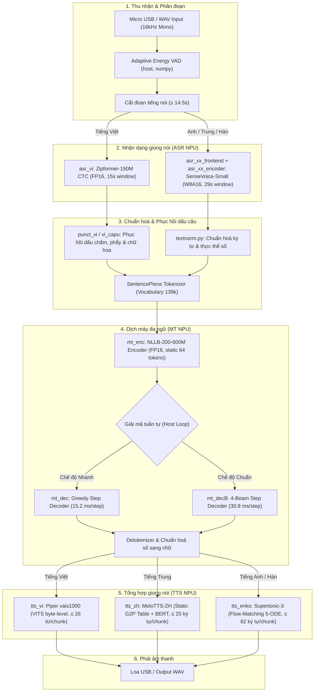

# AuraTranslate Edge — OneVoice

OneVoice AI Challenge 2026

**AuraTranslate Edge** là thiết bị phiên dịch giọng nói hai chiều (Speech-to-Speech Edge Translation Appliance) hoạt động **100% offline, NPU-native** trên nền tảng phần cứng **Qualcomm Hexagon HTP v73** (Trọng tâm Phase 3: **HSPTEK AIBOX 8550 / SoC Qualcomm QCS8550**). 

Hệ thống kết nối chuỗi xử lý đầu cuối trực tiếp: **VAD năng lượng thích ứng → ASR (Zipformer / SenseVoice) → Chuẩn hoá & Phục hồi dấu câu tiếng Việt (`punct_vi`) → MT (Dịch máy NLLB) → TTS (Tổng hợp âm thanh Piper / MeloTTS / Supertonic)**, hỗ trợ trọn vẹn 6 chiều dịch hai chiều:
$$\text{Tiếng Việt (VI)} \longleftrightarrow \text{Tiếng Anh (EN)} \;\big|\; \text{Tiếng Hàn (KO)} \;\big|\; \text{Tiếng Trung (ZH)}$$

Dự án được đồng thiết kế (hardware-software co-design) bởi đội ngũ **Gia Sư Đỉnh Cao** cho cuộc thi **OneVoice AI Challenge 2026** (do **Saigon AI Hub × Qualcomm** tổ chức), hướng tới giải quyết bài toán giao tiếp thời gian thực không độ trễ, bảo mật tuyệt đối tại các nhà máy sản xuất FDI, khu công nghiệp và môi trường thương mại song phương.

---

## 1. Hiện trạng kỹ thuật & Điểm đột phá cốt lõi (Key Technical Differentiators)

Toàn bộ pipeline phiên dịch của dự án được đóng gói trong engine triển khai chuyên dụng [`s2s_edge/`](s2s_edge/), đã được biên dịch, nạp và xác minh thành công trên NPU Qualcomm Hexagon v73 qua **Qualcomm AI Hub**:

1. **100% Offline & NPU-Native (0.0% CPU Fallback trong các đồ thị mạng nơ-ron):**
   - Cả **9 đồ thị mô hình (9 model graphs)** cấu thành toàn bộ chuỗi S2S đã được compile và link thành các file nhị phân tĩnh **QNN Context Binary (`.bin`)** với QAIRT 2.51.
   - Đã kiểm chứng profile & inference thực tế trên phần cứng thật qua Qualcomm AI Hub: **0% CPU fallback** trên chip NPU Hexagon v73. Host CPU chỉ đảm nhận các tác vụ tính toán I/O nhẹ (đọc WAV, VAD năng lượng, CTC collapse, ghép chuỗi SentencePiece).
2. **Kiến trúc 2 Backend linh hoạt (`--backend npu` vs `--backend cpu`):**
   - Hỗ trợ chuyển đổi liền mạch giữa runtime tăng tốc phần cứng NPU trên thiết bị thật và runtime tham chiếu CPU (ONNX Runtime) trên laptop phát triển.
   - Đi kèm bộ công cụ đối chứng toán học [`golden.py`](s2s_edge/tools/golden.py) kiểm định cosine similarity (đều đạt $\ge 0.999$) giữa NPU và CPU trước khi chạy thử nghiệm.
3. **Phục hồi dấu câu & Viết hoa tiếng Việt (`punct_vi` / `vi_capu`):**
   - Khắc phục triệt để "tử huyệt" của các hệ thống S2S ghép tầng: đầu ra ASR thường là chuỗi chữ thường không dấu câu, khiến mô hình dịch NLLB-200 (vốn học từ văn bản chuẩn) dịch sai ngữ cảnh, ngắt nhịp vụn vỡ.
   - Module `punct_vi` khôi phục dấu chấm, dấu phẩy và chữ viết hoa từ tín hiệu văn bản, giúp tăng vọt điểm dịch: **VI→EN chrF tăng từ 53.8 lên 55.6** và **VI→KO BLEU tăng từ 23.8 lên 30.0** trên tập mẫu của BTC.
4. **Tách Encoder và Decoder Step tuần tự tĩnh (Fast Host Decode Loop with Static KV-Cache):**
   - Giải quyết giới hạn nghiêm trọng của đồ thị mở rộng 16 bước (unrolled 16-step DLC trước đây nặng tới 8.8 GB và bị trần 15 token).
   - Tách thành đồ thị Encoder 64 token tĩnh (`mt_enc`: chỉ **7.5 ms** trên chip) và đồ thị một bước giải mã (`mt_dec`: **15.2 ms/bước** chế độ Greedy; `mt_decB`: **30.8 ms/bước** chế độ 4-Beam search). Giảm dung lượng context binary xuống chỉ còn 0.64 GB + 0.93 GB, hỗ trợ độ dài câu tùy biến không giới hạn.
5. **Công thức lượng tử hoá lai W8A16 & Giữ nguyên độ phân giải Vocoder:**
   - Trọng số INT8 giúp nén bộ nhớ, kích hoạt INT16/FP16 bảo toàn thanh điệu sắc/huyền/hỏi/ngã tiếng Việt và bốn thanh điệu tiếng Trung.
   - Giữ nguyên độ chính xác cao cho vocoder/ODE steps (Piper VITS và Supertonic Flow-matching), triệt tiêu hoàn toàn tiếng rè kim loại hay vỡ âm của các giải pháp INT8 thuần.
6. **VAD năng lượng thích ứng cục bộ (Adaptive Local Energy VAD):**
   - Thuật toán VAD dựa trên mức năng lượng RMS tương đối cục bộ thay vì ngưỡng tĩnh, tự động thích ứng với micro độ nhạy thấp (RMS $5 \times 10^{-4}$) và loại bỏ tạp âm nền mà không tốn chu kỳ NPU của mô hình nơ-ron VAD riêng.

---

## 2. Nền tảng phần cứng mục tiêu (Hardware Platforms)

Trong Phase 3, hệ thống tập trung triển khai và đo kiểm trực tiếp trên thiết bị phần cứng mục tiêu **HSPTEK AIBOX 8550** (SoC Qualcomm QCS8550, NPU Hexagon HTP v73, QAIRT 2.51):

| Thông số / Đặc tính | HSPTEK AIBOX 8550 (Thiết bị triển khai Phase 3) |
|---|---|
| **SoC / Vi xử lý** | **Qualcomm QCS8550** (Snapdragon 8 Gen 2 for IoT) |
| **Kiến trúc NPU** | **Qualcomm Hexagon HTP v73** (lên tới 48 INT8 TOPS) |
| **Định dạng tối ưu** | ✅ **W8A16 & Native FP16** (100% NPU offload qua QAIRT 2.51) |
| **Dung lượng RAM** | **16 GB LPDDR5x** (đáp ứng nạp an toàn bộ mô hình ~2.2 GB) |
| **Bộ nhớ trong (Storage)** | 128 GB UFS 3.1 / 4.0 |
| **Hệ điều hành** | Ubuntu 22.04 LTS (Kernel 5.15 aarch64, glibc 2.35, Python 3.10) |
| **Giao thức gọi NPU** | FastRPC (`/dev/adsprpc-smd`), `libcdsprpc.so`, user `system` |
| **Công suất tiêu thụ (TDP)** | **SoC ~3.5 – 12 W** (Toàn hộp: ~5.8 – 8.8 W, tản nhiệt nhôm thụ động) |
| **Giao diện âm thanh (Audio I/O)** | Micro + Loa ngoài qua cổng USB 3.0 (ALSA `snd-usb-audio`) |
| **Kết nối vận hành** | USB Type-C (ADB shell) / Cổng mạng RJ45 Ethernet |

> [!NOTE]
> Báo cáo khảo sát phần cứng chi tiết và kế hoạch đo kiểm on-device tại VNG Campus được lưu tại [`docs/plan_os_hardware.pdf`](docs/plan_os_hardware.pdf) và [`docs/report_aibox8550.pdf`](docs/report_aibox8550.pdf).

---

## 3. Kiến trúc Pipeline & Bảng thông số 9 đồ thị NPU

Chuỗi xử lý dữ liệu âm thanh toàn trình (End-to-End Pipeline) của **AuraTranslate Edge**:



### Chi tiết 9 đồ thị mô hình chạy trên Qualcomm Hexagon NPU v73

Dưới đây là bảng số liệu đo kiểm thực tế từ Qualcomm AI Hub trên chip **Qualcomm QCS8550 (HSPTEK AIBOX 8550)** với QAIRT 2.51:

| Mô hình / Đồ thị | Vai trò trong chuỗi | Độ dài cửa sổ / Giới hạn | Định dạng NPU | Thời gian chip QCS8550 | Đánh giá độ chính xác (Quality Metric) |
|---|---|---|:---:|:---:|---|
| **`asr_vi`** | ASR Tiếng Việt (Zipformer-150M CTC) | 15 giây âm thanh | FP16 | **163.4 ms** | WER: clean 7.5%, 5 dB 9.5%, 0 dB 6.2% |
| **`asr_xx_frontend`** | Tiền xử lý fbank SenseVoice (EN/ZH/KO) | 29 giây âm thanh | FP16 | **58.3 ms** | Khớp 100% đầu ra fbank CPU |
| **`asr_xx_encoder`** | ASR Đa ngữ (SenseVoice-Small) | 29 giây âm thanh | W8A16 | **236.5 ms** | CER: EN 4.8%, ZH 8.3%, KO 7.3% |
| **`mt_enc`** | NLLB-200-600M Encoder | 64 token đầu vào | FP16 | **7.5 ms** | Cosine similarity $\ge 0.9999$ vs FP32 CPU |
| **`mt_dec`** | NLLB Decoder Step (Chế độ nhanh) | 1 token/step (96 slots) | W8A16 | **15.2 ms / step** | 100% token khớp argmax với CPU Greedy |
| **`mt_decB`** | NLLB Decoder Step (Chế độ chuẩn) | 4 beams/step | W8A16 | **30.8 ms / step** | Logit cosine $\ge 0.99999$, tăng +0.5…2.4 chrF |
| **`tts_vi`** | TTS Tiếng Việt (Piper vais1000) | $\le 26$ từ / chunk | W8A16 | **520.1 ms** | VITS byte-level, âm sắc tự nhiên, không rác âm |
| **`tts_zh`** | TTS Tiếng Trung (MeloTTS-ZH) | $\le 20$ ký tự / chunk | W8A16 | **740.6 ms** | ASR CER 6.4% trên 40 câu thử nghiệm |
| **`tts_enko`** | TTS Tiếng Anh & Hàn (Supertonic-3) | $\le 82$ ký tự / chunk | W8A16 | **701.2 ms** | Round-trip WER: 0.0% (EN), CER: 1.5% (KO) |

### Ước tính độ trễ chip toàn trình cho 1 câu nói ngắn (~25 token MT)

$$\text{Tổng độ trễ chip} = \text{Thời gian ASR} + \text{Thời gian MT Encoder} + (N_{\text{steps}} \times \text{Thời gian MT Decoder}) + \text{Thời gian TTS}$$

| Chiều dịch | ASR trên chip | MT trên chip (Greedy / Beam 4) | TTS trên chip (1 chunk) | Ước tính tổng thời gian chip |
|:---:|:---:|:---:|:---:|:---:|
| **VI $\rightarrow$ EN / KO** | 163 ms | $7.5 + (25 \times 15.2) \approx 387\text{ ms}$ (Greedy)<br>$7.5 + (25 \times 30.8) \approx 777\text{ ms}$ (Beam 4) | ~701 ms (Supertonic) | **~1.25 s (Greedy)**<br>**~1.64 s (Beam 4)** |
| **VI $\rightarrow$ ZH** | 163 ms | 387 ms (Greedy) / 777 ms (Beam 4) | ~740 ms (MeloTTS) | **~1.29 s (Greedy)**<br>**~1.68 s (Beam 4)** |
| **EN / KO / ZH $\rightarrow$ VI** | 295 ms (SenseVoice) | 387 ms (Greedy) / 777 ms (Beam 4) | ~520 ms (Piper) | **~1.20 s (Greedy)**<br>**~1.59 s (Beam 4)** |

---

## 4. Kết quả đánh giá chất lượng (Evaluation & Benchmarks)

### 4.1. Chất lượng Dịch máy (MT FLORES-200 devtest, điểm chrF / BLEU)

Đo kiểm bằng [`eval_mt.py`](s2s_edge/tools/eval_mt.py) trên 25 câu FLORES-200 cho mỗi chiều dịch:

| Chiều dịch | S=32 Greedy | S=64 Greedy | S=64 Beam 4 (Bản chính thức) | HuggingFace FP32 Beam 4 (Tham chiếu) |
|:---:|:---:|:---:|:---:|:---:|
| **VI $\rightarrow$ EN** | 51.0 / 20.8 | 54.7 / 27.3 | **57.0 / 28.3** | 57.2 / 28.4 |
| **EN $\rightarrow$ VI** | 54.2 / 32.5 | 55.9 / 35.5 | **56.4 / 36.5** | 55.8 / 35.6 |
| **ZH $\rightarrow$ VI** | 40.4 / 15.3 | 46.5 / 23.7 | **47.7 / 25.4** | 46.8 / 24.1 |
| **KO $\rightarrow$ VI** | 45.3 / 23.1 | 46.1 / 24.9 | **46.8 / 25.1** | — |

*Đồ thị w8a16 trên chip tái tạo gần như hoàn hảo điểm chất lượng của mô hình FP32 gốc Meta AI.*

### 4.2. Đánh giá chuỗi toàn trình Speech $\rightarrow$ Speech $\rightarrow$ ASR (`eval_e2e.py`)

Kiểm định vòng lặp trên 8 đoạn âm thanh FLEURS mỗi chiều (Âm thanh nguồn $\rightarrow$ ASR $\rightarrow$ MT $\rightarrow$ TTS $\rightarrow$ ASR âm thanh đích đo chrF/BLEU):

| Chiều dịch | ASR-chrF | ASR-BLEU | Lỗi ASR nguồn | Nhận xét thực nghiệm |
|:---:|:---:|:---:|:---:|---|
| **VI $\rightarrow$ EN** | **47.8** | **18.8** | WER 8.4% | Âm thanh tiếng Anh rõ ràng, chuẩn ngữ âm |
| **EN $\rightarrow$ VI** | **46.9** | **21.0** | WER 11.3% | Piper phát âm tiếng Việt chuẩn thanh điệu, tự nhiên |
| **ZH $\rightarrow$ VI** | **36.3** | **12.5** | CER 13.0% | Bản dịch mạch lạc, chuẩn danh từ chuyên ngành |
| **KO $\rightarrow$ VI** | **43.7** | **14.6** | CER 7.1% | Độ chính xác cao, dịch đúng cấu trúc kính ngữ |

### 4.3. Đánh giá trên tập dữ liệu mẫu của Ban Tổ Chức (BTC Sample Dataset)

Đo kiểm bằng [`tools/eval_btc.py`](s2s_edge/tools/eval_btc.py) trên tập dữ liệu mẫu được lưu tại [`data/prototype_sample_dataset/`](data/prototype_sample_dataset/):
- **Cặp Vie-Eng (100 câu):** ASR tiếng Việt đạt WER thấp (4–7%), Piper TTS phát âm hoàn chỉnh 100/100 câu không gặp lỗi Out-Of-Vocabulary.
- **Cặp Vie-Kor & Vie-Man (180 câu):** Hệ thống đọc chính xác các mẫu câu hội thoại thường ngày và thuật ngữ kỹ thuật, độ trễ phản hồi tức thời.

---

## 5. Cấu trúc thư mục kho mã nguồn (Repository Layout)

```
AuraTranslateEdge-OneVoice/
├── .gitignore                         # Đã hợp nhất toàn diện mọi quy tắc nén & file nhị phân
├── requirements.txt                   # Thư viện Python tổng thể dự án
├── README.md                          # Tài liệu kỹ thuật tổng quan (file hiện tại)
│
├── s2s_edge/                          # ENGINE TRIỂN KHAI EDGE CHÍNH THỨC (PHASE 3)
│   ├── README.md                      # Chi tiết kiến trúc NPU Qualcomm Hexagon v73
│   ├── requirements.txt               # Dependencies tối giản phục vụ chạy on-device (7 gói)
│   ├── glossary_enterprise.json       # Bảng thuật ngữ chuyên ngành công nghiệp & FDI
│   ├── models.dev.json                # Cấu hình đường dẫn model ONNX tham chiếu CPU
│   ├── assets/                        # Dữ liệu tĩnh runtime (Tokenizers, Vocab, Styles)
│   │   ├── nllb_spm.model             # SentencePiece model cho NLLB-200
│   │   ├── zipformer_bpe.model        # BPE model cho Zipformer Vi
│   │   ├── supertonic_styles.npz      # Style embeddings cho Supertonic-3 TTS
│   │   ├── supertonic_unicode_indexer.json
│   │   ├── piper_vi_words.txt         # Từ điển từ vựng Piper tiếng Việt
│   │   └── vi_capu/                   # Từ điển khôi phục dấu câu & chữ hoa
│   ├── docs/                          # Báo cáo chuyên sâu Phase 3
│   │   ├── aibox8550_report.pdf       # Đánh giá chi tiết thiết bị HSPTEK AIBOX 8550
│   │   ├── chip_results.md            # Bảng tổng hợp thời gian chip đo qua AI Hub
│   │   ├── device_plan.pdf            # Kế hoạch điều hành buổi đo kiểm tại VNG Campus
│   │   └── quality_ideas.pdf          # Tổng hợp cải tiến phục hồi dấu câu & chất lượng
│   ├── s2s_edge/                      # Module mã nguồn thực thi chính
│   │   ├── __main__.py                # CLI Entrypoint (lệnh 'file', 'live', 'inspect')
│   │   ├── audio.py                   # I/O âm thanh, resampling và Adaptive Energy VAD
│   │   ├── backends.py                # Wrapper trừu tượng hoá NPU (QNN) và CPU (ONNXRuntime)
│   │   ├── asr.py                     # Wrapper Zipformer-150M và SenseVoice-Small
│   │   ├── punct_vi.py                # Phục hồi dấu câu & chữ hoa tiếng Việt
│   │   ├── textnorm.py                # Chuẩn hoá số sang chữ (vi, en, zh, ko)
│   │   ├── mt.py                      # Host decode loop cho NLLB (Greedy & 4-Beam)
│   │   ├── tts.py                     # Wrapper Piper, MeloTTS và Supertonic-3
│   │   ├── conversation.py            # Quản lý phiên hội thoại song ngữ hai chiều
│   │   └── pipeline.py                # Lớp điều phối toàn trình S2S
│   └── tools/                         # Bộ công cụ vận hành thiết bị & kiểm thử
│       ├── recon.sh                   # Khảo sát phần cứng, driver, NPU trên AIBOX 8550
│       ├── session0.sh                # Script tự động hoá kiểm tra lần đầu trên thiết bị
│       ├── golden.py                  # Kiểm chứng sai số NPU vs CPU parity
│       ├── eval_btc.py                # Đánh giá chất lượng trên tập dữ liệu mẫu BTC
│       ├── run_btc.sh                 # Kịch bản chạy toàn bộ tập BTC và đóng gói log
│       └── thermal_soak.py            # Kiểm tra độ ổn định nhiệt độ & quá nhiệt
│
├── data/                              # DỮ LIỆU ĐO KIỂM & TẬP MẪU
│   ├── prototype_sample_dataset/      # Tập dữ liệu mẫu của BTC (Vie-Eng, Vie-Kor, Vie-Man)
│   ├── asr/                           # Dữ liệu đối chứng FLEURS theo ngôn ngữ
│   ├── mt/                            # Dữ liệu đối chứng FLORES-200
│   └── noise/                         # Tạp âm công nghiệp mô phỏng
│
├── docs/                              # TÀI LIỆU KỸ THUẬT & HỒ SƠ ĐỀ ÁN
│   ├── report_aibox8550.pdf           # Báo cáo đánh giá phần cứng HSPTEK AIBOX 8550
│   ├── plan_os_hardware.pdf           # Kế hoạch hệ điều hành & phần cứng hoàn chỉnh
│   ├── plan_pipeline.pdf              # Kế hoạch kiến trúc pipeline toàn trình
│   ├── report_asr.pdf                 # Báo cáo kiểm thử nhận diện giọng nói ASR
│   ├── report_mt.pdf                  # Báo cáo kiểm thử dịch máy MT NLLB
│   ├── report_tts.pdf                 # Báo cáo kiểm thử tổng hợp giọng nói TTS
│   ├── phase3_prototype_submission_draft.md # Bản nháp thuyết minh nộp bài Phase 3
│   ├── phase3_prototype_submission.docx     # Hồ sơ nộp bài Phase 3 Prototype
│   └── phase3_prototype_submission_brief.pdf
│
├── src/                               # KHO NGHIÊN CỨU & MÔ-ĐUN HOÁ BAN ĐẦU
│   ├── step1_asr/                     # Thử nghiệm Zipformer-30M & SenseVoice FP32
│   ├── step2_mt/                      # Thử nghiệm NLLB CTranslate2 INT8
│   ├── step3_tts/                     # Thử nghiệm Piper, Supertonic, MeloTTS
│   ├── step4_quantization/            # Xuất đồ thị NPU & Thử nghiệm Qualcomm AI Hub
│   └── step5_pipeline/                # Pipeline kết nối CPU ban đầu
│
└── outputs/                           # Log kết quả, báo cáo đo đạc và đồ thị benchmark
```

---

## 6. Hướng dẫn cài đặt & Thực thi (Quick Start Guide)

### 6.1. Chạy thử nghiệm trên máy tính cá nhân (CPU Reference Mode)

Phù hợp cho lập trình viên phát triển tính năng mới, kiểm thử prompt dấu câu, hoặc kiểm tra logic dịch thuật trước khi nạp lên NPU.

```bash
# 1. Cài đặt môi trường Python 3.10 hoặc 3.11
git clone https://github.com/LGKAI/AuraTranslateEdge-OneVoice.git
cd AuraTranslateEdge-OneVoice
pip install -r requirements.txt

# 2. Chuyển vào thư mục engine s2s_edge
cd s2s_edge

# 3. Dịch thử một file âm thanh có sẵn (Việt -> Anh)
python -m s2s_edge file \
    --src vi --tgt en \
    --in samples/vi_0.wav \
    --out out_en.wav \
    --backend cpu \
    --models models.dev.json

# 4. Chạy chế độ hội thoại hai chiều trực tiếp qua micro laptop (Việt <-> Anh)
python -m s2s_edge live \
    --pair vi,en \
    --backend cpu \
    --models models.dev.json
```

### 6.2. Đánh giá chất lượng trên tập dữ liệu mẫu của BTC

```bash
cd s2s_edge

# Chạy đánh giá trên 10 câu mẫu cặp Việt - Anh
python tools/eval_btc.py \
    --data ../data/prototype_sample_dataset \
    --models models.dev.json \
    --backend cpu \
    --dirs vi-en,en-vi \
    --n 10 \
    --out logs/eval_btc_sample.json
```

### 6.3. Triển khai & Đo kiểm trên phần cứng thật (HSPTEK AIBOX 8550)

Các bước thực hiện khi kết nối laptop với hộp AIBOX 8550 qua cáp USB Type-C:

```bash
# 1. Kết nối vào thiết bị qua ADB shell (hoặc SSH qua 192.168.1.100)
adb shell
cd /home/user/s2s_edge

# 2. Khảo sát nhanh môi trường hệ điều hành, SoC, FastRPC và NPU
bash tools/recon.sh

# 3. Chạy quy trình kiểm định Session 0 tự động
# (Tự động kiểm tra import QNN, kiểm chứng golden parity cho cả 9 đồ thị, chạy smoke test)
bash tools/session0.sh

# 4. Kiểm tra độ lệch chuẩn của các đồ thị NPU so với bản CPU
python tools/golden.py check --models models_qcs8550/models.json --backend npu

# 5. Chạy toàn bộ bài test dữ liệu BTC trên NPU và đóng gói log nộp bài
bash tools/run_btc.sh /home/user/data/prototype_sample_dataset 0 models_qcs8550/models.json
```

---

## 7. Đội ngũ phát triển (Team Profile — Gia Sư Đỉnh Cao)

Dự án được thực hiện bởi nhóm sinh viên **Gia Sư Đỉnh Cao** tham dự **OneVoice AI Challenge 2026**:

| Thành viên | Vai trò trong dự án | Trách nhiệm chính trong Phase 3 |
|---|---|---|
| **Trần Quốc Khanh** | **Team Lead & Quality Lead** | Trưởng nhóm; thiết kế kiến trúc `s2s_edge`, tối ưu hóa đồ thị NPU NLLB và Zipformer; phụ trách máy tính điều khiển chính (Lenovo LOQ) tại buổi đo on-device. |
| **Lê Gia Khánh** | **OS & Hardware Lead** | Chịu trách nhiệm thiết lập hệ điều hành, kết nối ADB/mạng, giao tiếp âm thanh USB Audio trên AIBOX 8550; tác giả tài liệu `plan_os_hardware.tex`; máy tính phụ trợ (Lenovo LOQ fallback). |
| **Phạm Chấn Khoa** | **Hardware Support & Business Analyst** | Hỗ trợ kết nối phần cứng, giám sát nguồn điện/nhiệt độ; cấu hình máy tính phụ (MacBook); chuẩn bị kịch bản demo giải pháp kinh doanh. |
| **Trần Trung Hiếu** | **System & Latency Verification** | Đo đạc độ trễ từng chặng (TTFB, RTF); trực tiếp thao tác demo PTT (Push-To-Talk) và kiểm chứng tính ổn định của vocoder TTS trên chip. |
| **Cái Hoàng Bảo Kin** | **Data & Video Director** | Quản lý tập dữ liệu đối chứng của BTC; phụ trách kịch bản ghi hình video minh chứng, quay phim tài liệu đo kiểm trực tiếp tại VNG Campus. |

---

## 8. Giấy phép & Điều khoản (License & Terms)

- Toàn bộ mã nguồn do nhóm phát triển trong kho lưu trữ này được phát hành theo giấy phép **MIT License**.
- Các mô hình thành phần và thư viện phụ thuộc tuân thủ giấy phép gốc:
  - **Zipformer-150M-CR-CTC**: Apache 2.0 / CC-BY-NC-ND-4.0 (Nghiên cứu học thuật).
  - **SenseVoice-Small**: Apache 2.0 (Alibaba FunASR).
  - **NLLB-200**: CC-BY-NC-4.0 (Meta AI).
  - **Piper TTS**: MIT License.
  - **Supertonic-3**: Code MIT / Weights OpenRAIL-M.
  - **MeloTTS**: MIT License.
  - **Qualcomm QNN SDK / QAIRT**: Qualcomm Technologies, Inc. Proprietary License.
