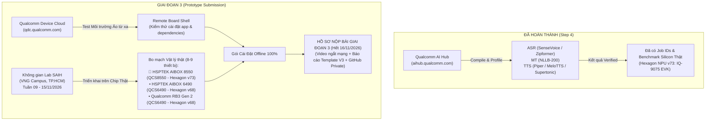

# 🚀 KẾ HOẠCH HÀNH ĐỘNG CHI TIẾT GIAI ĐOẠN 3 (PHASE 3 ROADMAP)
## Dự án: AuraTranslate Edge - OneVoice (Hệ thống Dịch Giọng nói Song ngữ Thời gian thực trên Hexagon NPU)
### Cuộc thi: OneVoice AI Challenge 2026 — Presented by Saigon AI Hub & Qualcomm

---

## 📌 TỔNG QUAN & CÁC MỐC THỜI GIAN SỐNG CÒN (CRITICAL MILESTONES)

| Mốc Thời Gian | Sự Kiện / Nhiệm Vụ | Mục Tiêu & Sản Phẩm Đầu Ra | Trách Nhiệm Chính |
| :--- | :--- | :--- | :--- |
| **14/10/2026** | **Công bố Brief Giai đoạn 3** | Tiếp nhận Brief, tải bộ mẫu dữ liệu 3 cặp ngôn ngữ (`data/phase3_sample_dataset`). BTC đã cập nhật bổ sung mẫu thiếu bộ VI-EN. | Toàn đội |
| **23/10/2026** *(17:00 - 18:00)* | **Qualcomm Technical Workshop** | Tham gia workshop trực tuyến (Zoom ID: `979 1341 4277`, Pass: `231026`). Nắm rõ Qualcomm AI Stack, QNN SDK, hướng dẫn đăng ký thiết bị QDC. | Đại diện: Hiếu, Khanh |
| **24/10 – 08/11/2026** | **Sprint 1 & 2: Benchmark Dataset, Tối ưu QDC & Đóng gói E2E** | Chạy benchmark tự động 600 câu dữ liệu BTC; đăng ký ưu tiên QDC; đóng gói pipeline offline 100% không phụ thuộc internet. | Khoa, Hiếu, Khanh |
| **09/11 – 15/11/2026** | **Sprint 3: Lab Thực Tế Tại VNG Campus & Kịch bản UX** | Lên VNG Campus kiểm thử trên thiết bị thật (**Target: HSPTEK AIBOX 8550 - QCS8550 Hexagon v73**); đo telemetry on-device; thiết kế vỏ 3D. | Toàn đội (Target: Hiếu, Khanh, Kin) |
| **14/11 – 16/11/2026** | **Sprint 4: Quay Video Demo Ngắt Mạng, Set Private Repo & Nộp Bài** | Quay video chứng minh 100% Offline (Airplane Mode); đặt GitHub **Private** và invite `saigonaihub`; hoàn thiện báo cáo Template V3. | Toàn đội (Lead: Khanh) |
| **16/11/2026** *(Hết ngày, UTC+7)* | **HẠN NỘP MỚI GIA HẠN (DEADLINE CHÍNH THỨC)** | **Nộp hoàn tất qua Google Form:** Link GitHub **Private** (cấp quyền `saigonaihub`), Link Google Drive (Video + Gói cài đặt + Báo cáo `.pdf`). | Khanh (Đại diện) |
| **23/11/2026** | **Công bố Kết quả Vòng Prototype** | BTC và BGK chấm điểm đối chiếu benchmark độc lập trên tập test ẩn 1,000 câu. | BTC |
| **28/11/2026** | **Giai đoạn Field-Testing** | Thử nghiệm vận hành thực tế trực tiếp trên thiết bị tại VNG Campus. | Toàn đội |
| **05/12/2026** | **VÒNG CHUNG KẾT (GRAND FINAL)** | Thuyết trình & Trình diễn trực tiếp sản phẩm tại VNG Campus (TP.HCM). | Toàn đội |

---

## 🎯 CƠ CẤU ĐIỂM SỐ & CHIẾN LƯỢC CHIẾM LĨNH ĐIỂM TỐI ĐA (SCORING STRATEGY)

Theo Quy chế Brief Vòng 3 của BTC, tổng điểm được cấu thành từ 4 trụ cột kỹ thuật (100%) và 1 cơ chế điểm thưởng (+0.5 điểm):

```
┌────────────────────────────────────────────────────────────────────────────────────────┐
│                   TỔNG ĐIỂM ĐÁNH GIÁ PROTOTYPE (100% + 0.5 BONUS)                      │
├───────────────────────────────┬────────────────────────────────────────────────────────┤
│ A. Chất lượng Dịch (45%)      │ • Hội thoại song ngữ tự nhiên, độ chính xác cao        │
│    (Voice-to-Voice Quality)   │ • Đầy đủ 3 cặp ngôn ngữ: VI ↔ EN, VI ↔ ZH, VI ↔ KO     │
├───────────────────────────────┼────────────────────────────────────────────────────────┤
│ B. Hiệu năng On-device (20%)  │ • 100% Offline (Không gọi cloud/API tại demo time)      │
│    (On-device Performance)    │ • Tối ưu NPU Hexagon, RAM đỉnh thấp, Latency < 1.5s    │
├───────────────────────────────┼────────────────────────────────────────────────────────┤
│ C. Tích hợp Thiết bị & UX (20%)│ • Giao diện 1 chạm (Web UI / PTT Physical Button)     │
│    (Device Integration & UX)  │ • Thiết kế tối ưu cho công nhân công trường / kho vận  │
├───────────────────────────────┼────────────────────────────────────────────────────────┤
│ D. Hồ sơ Demo & Tài liệu (15%)│ • Video có chứng minh ngắt mạng (Airplane mode)        │
│    (Demo Package)             │ • Khả năng tái lập 1-Click (Docker / Run Script)       │
├───────────────────────────────┼────────────────────────────────────────────────────────┤
│ 🌟 Điểm Cộng Phần Cứng (+0.5) │ • Thiết kế vỏ bảo vệ in 3D cầm tay / tai nghe PTT      │
│    (Hardware Bonus)           │ • Tích hợp module pin độc lập & chống bụi ồn công trường│
└───────────────────────────────┴────────────────────────────────────────────────────────┘
```

---

## 👥 PHÂN CÔNG NHIỆM VỤ CHI TIẾT (RACI MATRIX - 5 THÀNH VIÊN)

| Thành viên | Vai Trò Chính | Nhiệm Vụ Trọng Tâm Giai Đoạn 3 | Sản Phẩm Bàn Giao Cụ Thể |
| :--- | :--- | :--- | :--- |
| **Khanh** | **Team Leader & Pipeline Architect** | • Điều phối lộ trình tổng thể và kiểm soát chất lượng hồ sơ nộp.<br>• Tối ưu mô-đun Dịch máy **NLLB-200** (FP16/W8A16) trên NPU.<br>• Hoàn thiện Pipeline tích hợp E2E (`step5_pipeline`) và cơ chế chống ảo giác/lỗi phát âm (**Quality-gated retry**).<br>• Chịu trách nhiệm chính hoàn thiện bản Báo cáo Kỹ thuật Template V3. | • Pipeline E2E hoàn chỉnh chạy offline 100%.<br>• Bản báo cáo PDF `[AuraTranslateEdge]_Prototype Submission_V3.pdf`. |
| **Khánh** | **ASR Specialist & UX/Scenario Lead** | • Kiểm thử và tối ưu mô hình nhận dạng giọng nói **Zipformer & SenseVoice-Small** trên NPU.<br>• Xây dựng **Kịch bản hội thoại thực tế 30 phút** (bối cảnh: Giám sát công trường đa quốc gia Việt - Hàn - Trung - Anh).<br>• Thiết kế trải nghiệm người dùng (UX) và tối ưu độ nhạy âm thanh đầu vào mic. | • Bộ kịch bản hội thoại 30 phút song ngữ kèm audio test.<br>• Bảng telemetry nhận dạng giọng nói (WER/CER) trên dữ liệu BTC. |
| **Khoa** | **Dataset Benchmark & Business Analyst** | • Quản lý và xử lý tự động hóa bộ dữ liệu mẫu Phase 3 (`phase3_sample_dataset`).<br>• Viết script đo đạc độ chính xác tự động toàn bộ 600 câu (BLEU, chrF++, CER, RTF).<br>• Đảm nhiệm phần tối ưu mô hình **Supertonic-v3 TTS** và phụ trách phân tích tính khả thi kinh doanh (Business Case & Go-to-market). | • Script benchmark tự động `eval_phase3_sample_dataset.py`.<br>• Báo cáo đối chiếu số liệu định lượng có kèm log minh chứng. |
| **Hiếu** | **Hardware & Quantization Engineer** | • Phụ trách kỹ thuật nền tảng **Qualcomm AI Hub** & **Qualcomm Device Cloud (QDC)**.<br>• Tối ưu mô hình **MeloTTS** (1-graph NPU end-to-end từ byte UTF-8 ra audio 44.1 kHz).<br>• Trực tiếp tham gia phiên lab phần cứng tại SAIH (VNG Campus), nạp và đo đạc telemetry trên bo mạch thật (**Target chính: HSPTEK AIBOX 8550 - chip QCS8550 Hexagon v73**, cùng các dòng QCS6490 / RB3 Gen 2). | • Toàn bộ model QNN context binary / ONNX tối ưu NPU.<br>• Raw logs, telemetry về nhiệt độ, điện năng và độ trễ trên chip vật lý. |
| **Kin** | **Form Factor & Video/Media Lead** | • Tối ưu mô hình **Piper VITS** (`fullg8` 100% NPU, 480ms).<br>• Thiết kế **Form Factor phần cứng** (vỏ hộp in 3D công thái học, nút bấm cơ học Push-To-Talk) để lấy trọn **+0.5 điểm thưởng**.<br>• Đạo diễn và quay dựng **Video Demo End-to-End** đạt chuẩn BTC (có phân cảnh ngắt mạng / Airplane Mode rõ ràng). | • Bản vẽ 3D CAD/vỏ prototype thực tế cầm tay.<br>• Video demo 100% offline chất lượng cao full HD. |

---

## 📅 LỘ TRÌNH TRIỂN KHAI 4 SPRINT CHI TIẾT (WEEKLY SPRINT BREAKDOWN)

### SPRINT 1: Thiết lập Hạ tầng QDC, Đánh giá Dữ liệu Phase 3 & Workshop Qualcomm
**Thời gian:** 23/10/2026 – 31/10/2026

* [x] **Ngày 23/10 (17h00 - 18h00):** Cử đại diện tham dự đầy đủ **Technical Workshop với Qualcomm**:
  - Ghi nhận thông tin công cụ Qualcomm SDK/QNN, hướng dẫn tối ưu mô hình trên thiết bị.
  - Nắm bắt quy trình đăng ký thiết bị Qualcomm Device Cloud (QDC).
* [x] **Đăng ký thiết bị trên Qualcomm Device Cloud (QDC):**
  - Tạo tài khoản và gửi yêu cầu tại [https://qdc.qualcomm.com/](https://qdc.qualcomm.com/).
  - **Lưu ý quan trọng từ BTC:** Khi gửi yêu cầu, bắt buộc ghi rõ: *"Tham gia cuộc thi OneVoice AI Challenge 2026 - Đội thi: AuraTranslate Edge"* để Team Qualcomm ưu tiên xét duyệt xử lý trong danh sách chờ.
* [x] **Chạy Benchmark Toàn diện trên `phase3_sample_dataset`:**
  - BTC đã rà soát và bổ sung các mẫu bị thiếu cho bộ dữ liệu mẫu VI-EN (`Vie-EngDataset`).
  - Nạp đầy đủ 3 bộ dữ liệu:
    * `Vie-EngDataset`: 100 câu VI $\rightarrow$ EN và 100 câu EN $\rightarrow$ VI (đã cập nhật bản bổ sung từ BTC).
    * `Vie-KorDataset`: 100 câu VI $\rightarrow$ KO và 100 câu KO $\rightarrow$ VI.
    * `Vie-ManDataset`: 100 câu VI $\rightarrow$ ZH và 100 câu ZH $\rightarrow$ VI.
  - Đo các chỉ số: WER (%) của ASR, BLEU / chrF++ của MT, CER (%) Round-trip của TTS. Lưu toàn bộ kết quả vào thư mục `results/phase3_benchmarks/`.

---

### SPRINT 2: Đóng gói Pipeline 100% Offline & Kịch bản 30 Phút
**Thời gian:** 01/11/2026 – 08/11/2026

* [x] **Đóng gói Pipeline E2E Offline Triệt để:**
  - Đảm bảo 100% các file trọng số (weights), tokenizer, từ điển phoneme, config nằm cục bộ trong thư mục dự án.
  - Thử nghiệm ngắt kết nối mạng (tắt Wi-Fi / rút cáp Ethernet): toàn bộ hệ thống vẫn khởi động và suy luận trơn tru, không phụ thuộc bất kỳ API đám mây nào.
* [x] **Xây dựng Kịch bản Hội thoại Thực tế 30 Phút & Minimal UX:**
  - **Bối cảnh:** Điều hành và giám sát an toàn tại công trường xây dựng / nhà xưởng FDI quốc tế (Kỹ sư Việt Nam giao tiếp với Quản đốc Trung Quốc, Chuyên gia Hàn Quốc, Giám sát viên tiếng Anh).
  - Tích hợp giao diện Dashboard Web (`asr_demo_server.py`, `mt_demo_server.py`, `tts_demo_server.py`) hỗ trợ Push-To-Talk (PTT) 1 chạm và giám sát telemetry.
* [x] **Thiết kế Form Factor & Vỏ Hộp Bảo Vệ (+0.5 Điểm Thưởng Phần Cứng):**
  - Thiết kế mô hình 3D vỏ hộp cầm tay / gắn áo công thái học (Walkie-Talkie style) tối ưu cho môi trường nhà xưởng độ ồn cao.

---

### SPRINT 3: Kiểm thử Trực tiếp trên Thiết bị Thật tại VNG Campus (Saigon AI Hub)
**Thời gian:** 09/11/2026 – 15/11/2026 *(Tuần BTC mở lab thử nghiệm phần cứng)*

* [ ] **Tiếp nhận Thiết bị & Đăng ký Slot Lab tại VNG Campus:**
  - Theo thông báo mới nhất của BTC: 8 – 9 thiết bị (được chuyển từ Hà Nội vào TP.HCM) sẽ sẵn sàng trong tuần **09 – 15/11/2026**.
  - Danh sách thiết bị vật lý tại Campus gồm:
    1. **HSPTEK AIBOX 8550 (chip Qualcomm QCS8550):** **🎯 THIẾT BỊ MỤC TIÊU SỐ 1 CỦA NHÓM.**
       > *Lý do kỹ thuật cốt lõi:* QCS8550 sử dụng cùng thế hệ kiến trúc **Hexagon NPU v73** như Dragonwing IQ-9075 EVK mà nhóm đã tối ưu trên AI Hub. Toàn bộ các mô hình Native FP16, W8A16, Single Static DAG và QNN Context Binary của nhóm đều tương thích trực tiếp!
    2. **HSPTEK AIBOX 6490 (chip Qualcomm QCS6490):** Thiết bị biên Hexagon v68.
    3. **Qualcomm RB3 Gen 2 Development Kit (chip Qualcomm QCS6490):** Bo mạch phát triển Hexagon v68.
  - Chờ email xác nhận lịch từ BTC và cử đại diện (Hiếu, Khanh) đến VNG Campus đúng giờ.
  - *(Lưu ý: Nếu cần hỗ trợ kỹ thuật tại Hà Nội, liên hệ anh Khanh Lê - chuyên gia Qualcomm: `vankle@qti.qualcomm.com`, CC `info@saigonaihub.com`).*
* [ ] **Thực thi Đo đạc Telemetry & Quay Cảnh Chạy trên Phần cứng Thật:**
  - Nạp gói cài đặt lên thiết bị **HSPTEK AIBOX 8550 (QCS8550)**.
  - Đo đạc thực tế: Độ trễ (Latency), RAM đỉnh, nhiệt độ bo mạch, và tỷ lệ 100% NPU compute.
  - Ghi lại video/ảnh chụp thiết bị vật lý đang vận hành trơn tru tại VNG Campus để đưa vào Video Demo và Báo cáo.

---

### SPRINT 4: Sản xuất Video Demo Ngắt Mạng, Hoàn tất Template V3 & Nộp Bài
**Thời gian:** 14/11/2026 – 16/11/2026 *(Hạn chót gia hạn mới: Hết ngày 16/11/2026)*

* [ ] **Sản xuất Video Demo End-to-End (Bắt buộc):**
  - **Yêu cầu sống còn của BTC:** Video **PHẢI CÓ CẢNH NGẮT KẾT NỐI MẠNG** (bật Airplane mode hoặc rút dây cáp mạng / ngắt Wi-Fi) ngay trước khi thực hiện demo hội thoại để chứng minh 100% offline.
  - Độ dài chuẩn: 3 – 5 phút, có phụ đề song ngữ, trình diễn mượt mà trên phần cứng.
* [ ] **Cập nhật Chế độ Bảo mật Repository GitHub (QUY ĐỊNH MỚI TỪ BTC):**
  - **CHUYỂN REPOSITORY SANG CHẾ ĐỘ PRIVATE (RIÊNG TƯ)** để bảo vệ mã nguồn.
  - Cấp quyền truy cập (Collaborator) cho tài khoản chính thức của Saigon AI Hub: **`https://github.com/saigonaihub`**.
* [ ] **Hoàn thiện Báo cáo Prototype Submission Template V3:**
  - Hoàn thiện theo mẫu của BTC: `https://docs.google.com/document/d/1Xlet4NzISCvfNRYSf06F_0s_E5n4a7y7/edit`.
  - Xuất ra file PDF chuẩn: `[AuraTranslateEdge]_Prototype Submission_V3.pdf`.
* [ ] **Nộp hồ sơ qua Google Form BTC trước 23h59 ngày 16/11/2026:**
  - Link Form nộp bài: [https://forms.gle/Qhdni9hdFm19ZJfF6](https://forms.gle/Qhdni9hdFm19ZJfF6).
  - Link Video Demo (YouTube Unlisted / Google Drive).
  - Link GitHub Private (đã invite `saigonaihub`).
  - Link Google Drive chứa Báo cáo PDF, gói cài đặt và model weights.

---

## 🛠️ CHIẾN LƯỢC HẠ TẦNG: QUALCOMM AI HUB vs QDC vs THIẾT BỊ VẬT LÝ TẠI SAIH



1. **Qualcomm AI Hub:** Tiếp tục sử dụng khi cần re-compile hoặc xuất định dạng QNN mới nếu có tinh chỉnh về kiến trúc.
2. **Qualcomm Device Cloud (QDC):** Đóng vai trò là môi trường diễn tập (staging environment) để cấu hình thử nghiệm các package Linux/Android trước khi lên thiết bị thật.
3. **Phần cứng vật lý tại SAIH (VNG Campus):** Đóng vai trò là môi trường nghiệm thu thực tế (production environment) để lấy video minh chứng và số liệu chính thức nộp bài. **Trọng tâm lựa chọn là HSPTEK AIBOX 8550 (QCS8550)** do có cùng nhân **Hexagon NPU v73**, tương thích 100% với toàn bộ pipeline W8A16 và QNN DLC mà nhóm đã tối ưu.

---

## 📋 CHECKLIST KIỂM SOÁT CHẤT LƯỢNG NỘP HỒ SƠ (DEFINITION OF DONE)

- [ ] **Mã nguồn:** Toàn bộ code được dọn dẹp sạch sẽ, có comment rõ ràng, đặt ở chế độ **PRIVATE (Riêng tư)** trên GitHub.
- [ ] **Cấp quyền truy cập BTC:** Đã thêm tài khoản Saigon AI Hub (**`https://github.com/saigonaihub`**) làm Collaborator truy cập repository.
- [ ] **File `.gitignore`:** Đã chặn toàn bộ các dataset nặng (`data/phase3_sample_dataset/`, `*.wav`, `outputs/`) để repo gọn gàng dưới 100MB.
- [ ] **Bằng chứng ngắt mạng (Bắt buộc):** Video demo có đoạn quay rõ hành động ngắt kết nối Internet (Airplane mode / ngắt Wi-Fi / rút cáp LAN) trên thiết bị trước khi demo.
- [ ] **Đa ngôn ngữ:** Chạy thực tế thành công cả 3 cặp ngôn ngữ: Tiếng Việt ↔ Tiếng Anh, Tiếng Việt ↔ Tiếng Trung, Tiếng Việt ↔ Tiếng Hàn.
- [ ] **Độ chính xác định lượng:** Báo cáo có bảng số liệu benchmark đo trên dữ liệu mẫu BTC (WER, BLEU, ASR Round-trip CER).
- [ ] **Tài liệu nộp bài:** File báo cáo PDF trình bày chuyên nghiệp, đúng Template V3 của BTC, không lỗi chính tả, đúng định dạng tên `[AuraTranslateEdge]_Prototype Submission_V3.pdf`.
- [ ] **Hạn chót:** Hoàn tất nộp form trước 23h59 ngày **16/11/2026** (giờ Việt Nam).
