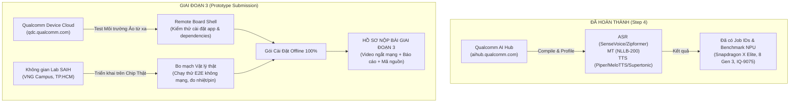

# 🚀 KẾ HOẠCH HÀNH ĐỘNG CHI TIẾT GIAI ĐOẠN 3 (PHASE 3 ROADMAP)
## Dự án: AuraTranslate Edge - OneVoice (Hệ thống Dịch Giọng nói Song ngữ Thời gian thực trên Hexagon NPU)
### Cuộc thi: OneVoice AI Challenge 2026 — Presented by Saigon AI Hub & Qualcomm

---

## 📌 TỔNG QUAN & CÁC MỐC THỜI GIAN SỐNG CÒN (CRITICAL MILESTONES)

| Mốc Thời Gian | Sự Kiện / Nhiệm Vụ | Mục Tiêu & Sản Phẩm Đầu Ra | Trách Nhiệm Chính |
| :--- | :--- | :--- | :--- |
| **14/10/2026** | **Công bố Brief Giai đoạn 3** | Tiếp nhận Brief, tải bộ mẫu dữ liệu 3 cặp ngôn ngữ (`data/phase3_sample_dataset`). | Toàn đội |
| **23/10/2026** *(17:00 - 18:00)* | **Qualcomm Technical Workshop** | Tham gia workshop trực tuyến (Zoom ID: `979 1341 4277`, Pass: `231026`). Nắm rõ Qualcomm AI Stack, QNN SDK, đăng ký thiết bị QDC. | Đại diện: Hiếu, Khanh |
| **24/10 – 30/10/2026** | **Sprint 1: Benchmark Dataset Phase 3 & Tối ưu QDC** | Chạy kiểm thử tự động 600 mẫu dữ liệu mẫu BTC; triển khai môi trường Qualcomm Device Cloud (QDC). | Khoa, Hiếu |
| **31/10 – 06/11/2026** | **Sprint 2: Đóng gói Pipeline E2E & Test Thiết bị tại SAIH** | Tích hợp chuỗi offline 100% không mạng; lên trực tiếp SAIH (VNG Campus) kiểm thử trên bo mạch thật. | Khanh, Hiếu, Kin |
| **07/11 – 10/11/2026** | **Sprint 3: Xây dựng Kịch bản 30p, UX & Thiết kế Vỏ Form Factor** | Kịch bản hội thoại thực tế (nhà máy/kho vận/công trường); thiết kế vỏ prototype cầm tay (săn điểm cộng +0.5). | Khánh, Kin |
| **11/11 – 13/11/2026** | **Sprint 4: Quay Video Demo Ngắt Mạng & Hoàn tất Hồ sơ** | Quay video chứng minh 100% Offline (bật Airplane Mode); hoàn thiện báo cáo Template V3; nộp cổng BTC. | Toàn đội (Lead: Khanh) |
| **13/11/2026** *(23:59 UTC+7)* | **DEADLINE NỘP HỒ SƠ PROTOTYPE** | **Nộp hoàn tất qua Google Form:** Link GitHub Public, Link Google Drive (Video + Gói cài đặt + Báo cáo `.pdf`). | Khanh (Đại diện) |
| **23/11/2026** | **Công bố Kết quả Vòng Prototype** | BTC và BGK chấm điểm đối chiếu benchmark độc lập trên tập test ẩn 1,000 câu. | BTC |
| **28/11/2026** | **Giai đoạn Field-Testing** | Thử nghiệm vận hành thực tế trực tiếp trên thiết bị tại VNG Campus. | Toàn đội |
| **05/12/2026** | **VÒNG CHUNG KẾT (GRAND FINAL)** | Thuyết trình & Trình diễn trực tiếp sản phẩm tại VNG Campus (TP.HCM). | Toàn đội |

---

## 🎯 CƠ CẤU ĐIỂM SỐ & CHIẾN LƯỢC CHIẾM LĨNH ĐIỂM TỐI ĐA (SCORING STRATEGY)

Theo Quy chế Brief Vòng 3 của BTC, tổng điểm được cấu thành từ 4 trụ cột kỹ thuật (100%) và 1 cơ chế điểm thưởng (+0.5 điểm):

```
┌────────────────────────────────────────────────────────────────────────────────────────┐
│                   TỔNG ĐIỂM ĐÁNH GIÁ PROTOTYPE (100% + 0.5 BONUS)                      │
├───────────────────────────────┬────────────────────────────────────────────────────────┤
│ A. Chất lượng Dịch (45%)      │ • Hội thoại song ngữ tự nhiên, độ chính xác cao        │
│    (Voice-to-Voice Quality)   │ • Đầy đủ 3 cặp ngôn ngữ: VI ↔ EN, VI ↔ ZH, VI ↔ KO     │
├───────────────────────────────┼────────────────────────────────────────────────────────┤
│ B. Hiệu năng On-device (20%)  │ • 100% Offline (Không gọi cloud/API tại demo time)      │
│    (On-device Performance)    │ • Tối ưu NPU Hexagon, RAM đỉnh thấp, Latency < 1.5s    │
├───────────────────────────────┼────────────────────────────────────────────────────────┤
│ C. Tích hợp Thiết bị & UX (20%)│ • Giao diện 1 chạm (Web UI / PTT Physical Button)     │
│    (Device Integration & UX)  │ • Thiết kế tối ưu cho công nhân công trường / kho vận  │
├───────────────────────────────┼────────────────────────────────────────────────────────┤
│ D. Hồ sơ Demo & Tài liệu (15%)│ • Video có chứng minh ngắt mạng (Airplane mode)        │
│    (Demo Package)             │ • Khả năng tái lập 1-Click (Docker / Run Script)       │
├───────────────────────────────┼────────────────────────────────────────────────────────┤
│ 🌟 Điểm Cộng Phần Cứng (+0.5) │ • Thiết kế vỏ bảo vệ in 3D cầm tay / tai nghe PTT      │
│    (Hardware Bonus)           │ • Tích hợp module pin độc lập & chống bụi ồn công trường│
└───────────────────────────────┴────────────────────────────────────────────────────────┘
```

---

## 👥 PHÂN CÔNG NHIỆM VỤ CHI TIẾT (RACI MATRIX - 5 THÀNH VIÊN)

| Thành viên | Vai Trò Chính | Nhiệm Vụ Trọng Tâm Giai Đoạn 3 | Sản Phẩm Bàn Giao Cụ Thể |
| :--- | :--- | :--- | :--- |
| **Khanh** | **Team Leader & Pipeline Architect** | • Điều phối lộ trình tổng thể và kiểm soát chất lượng hồ sơ nộp.<br>• Tối ưu mô-đun Dịch máy **NLLB-200** (FP16/W8A16) trên NPU.<br>• Hoàn thiện Pipeline tích hợp E2E (`step5_pipeline`) và cơ chế chống ảo giác/lỗi phát âm (**Quality-gated retry**).<br>• Chịu trách nhiệm chính hoàn thiện bản Báo cáo Kỹ thuật Template V3. | • Pipeline E2E hoàn chỉnh chạy offline 100%.<br>• Bản báo cáo PDF `[AuraTranslateEdge]_Prototype Submission_V3.pdf`. |
| **Khánh** | **ASR Specialist & UX/Scenario Lead** | • Kiểm thử và tối ưu mô hình nhận dạng giọng nói **Zipformer & SenseVoice-Small** trên NPU.<br>• Xây dựng **Kịch bản hội thoại thực tế 30 phút** (bối cảnh: Giám sát công trường đa quốc gia Việt - Hàn - Trung - Anh).<br>• Thiết kế trải nghiệm người dùng (UX) và tối ưu độ nhạy âm thanh đầu vào mic. | • Bộ kịch bản hội thoại 30 phút song ngữ kèm audio test.<br>• Bảng telemetry nhận dạng giọng nói (WER/CER) trên dữ liệu BTC. |
| **Khoa** | **Dataset Benchmark & Business Analyst** | • Quản lý và xử lý tự động hóa bộ dữ liệu mẫu Phase 3 (`phase3_sample_dataset`).<br>• Viết script đo đạc độ chính xác tự động toàn bộ 600 câu (BLEU, chrF++, CER, RTF).<br>• Đảm nhiệm phần tối ưu mô hình **Supertonic-v3 TTS** và phụ trách phân tích tính khả thi kinh doanh (Business Case & Go-to-market). | • Script benchmark tự động `eval_phase3_sample_dataset.py`.<br>• Báo cáo đối chiếu số liệu định lượng có kèm log minh chứng. |
| **Hiếu** | **Hardware & Quantization Engineer** | • Phụ trách kỹ thuật nền tảng **Qualcomm AI Hub** & **Qualcomm Device Cloud (QDC)**.<br>• Tối ưu mô hình **MeloTTS** (1-graph NPU end-to-end từ byte UTF-8 ra audio 44.1 kHz).<br>• Trực tiếp tham gia phiên lab phần cứng tại SAIH (VNG Campus), nạp và đo đạc telemetry trên bo mạch thật (Snapdragon X Elite, QCS6490, IQ-9075). | • Toàn bộ model QNN context binary / ONNX tối ưu NPU.<br>• Raw logs, telemetry về nhiệt độ, điện năng và độ trễ trên chip vật lý. |
| **Kin** | **Form Factor & Video/Media Lead** | • Tối ưu mô hình **Piper VITS** (`fullg8` 100% NPU, 480ms).<br>• Thiết kế **Form Factor phần cứng** (vỏ hộp in 3D công thái học, nút bấm cơ học Push-To-Talk) để lấy trọn **+0.5 điểm thưởng**.<br>• Đạo diễn và quay dựng **Video Demo End-to-End** đạt chuẩn BTC (có phân cảnh ngắt mạng / Airplane Mode rõ ràng). | • Bản vẽ 3D CAD/vỏ prototype thực tế cầm tay.<br>• Video demo 100% offline chất lượng cao full HD. |

---

## 📅 LỘ TRÌNH TRIỂN KHAI 4 SPRINT CHI TIẾT (WEEKLY SPRINT BREAKDOWN)

### SPRINT 1: Thiết lập Hạ tầng QDC, Đánh giá Dữ liệu Phase 3 & Workshop Qualcomm
**Thời gian:** 23/10/2026 – 29/10/2026

* [x] **Ngày 23/10 (17h00 - 18h00):** Cử đại diện tham dự đầy đủ **Technical Workshop với Qualcomm**:
  - Ghi nhận thông tin về các dòng vi xử lý NPU được hỗ trợ tại VNG Campus (Snapdragon X Elite, RB3 Gen 2, IQ-9075, Snapdragon 8 Gen 3).
  - Trao đổi với kỹ sư Qualcomm về cơ chế nạp QNN Runtime C++ và chia sẻ bộ nhớ zero-copy.
* [ ] **Đăng ký thiết bị trên Qualcomm Device Cloud (QDC):**
  - Tạo tài khoản và gửi yêu cầu cấp quyền thiết bị tại [https://qdc.qualcomm.com/devices](https://qdc.qualcomm.com/devices).
  - Ghi chú đúng cú pháp ưu tiên: *"Tham gia cuộc thi OneVoice AI Challenge 2026 - Đội thi: AuraTranslate Edge"*.
* [ ] **Chạy Benchmark Toàn diện trên `phase3_sample_dataset`:**
  - Viết script `src/step5_pipeline/benchmark_phase3.py` nạp tự động dữ liệu:
    * `Vie-EngDataset`: 100 câu VI $\rightarrow$ EN và 100 câu EN $\rightarrow$ VI.
    * `Vie-KorDataset`: 100 câu VI $\rightarrow$ KO và 100 câu KO $\rightarrow$ VI.
    * `Vie-ManDataset`: 100 câu VI $\rightarrow$ ZH và 100 câu ZH $\rightarrow$ VI.
  - Đo các chỉ số: WER (%) của ASR, BLEU / chrF++ của MT, CER (%) Round-trip của TTS.
  - Lưu toàn bộ kết quả vào thư mục `results/phase3_benchmarks/` làm minh chứng thực đo.

---

### SPRINT 2: Đóng gói Pipeline 100% Offline & Kiểm thử Trực tiếp tại Phòng Lab SAIH
**Thời gian:** 30/10/2026 – 05/11/2026

* [ ] **Đóng gói Pipeline E2E Offline Triệt để:**
  - Đảm bảo 100% các file trọng số (weights), tokenizer, từ điển phoneme, config nằm cục bộ trong thư mục dự án.
  - Thêm script kiểm tra ngắt mạng tự động: Nếu ngắt Wi-Fi / Ethernet, toàn bộ hệ thống vẫn khởi động và suy luận trơn tru trong < 1.5 giây.
* [ ] **Kiểm thử trên Thiết bị Vật lý tại VNG Campus (Saigon AI Hub):**
  - Đăng ký slot thiết bị phần cứng tại không gian SAIH ngay khi BTC mở cổng.
  - Nạp mô hình lên bo mạch thật (target chính: Snapdragon X Elite / Qualcomm IQ-9075 / QCS6490).
  - Đo đạc các chỉ số khắt khe từ phần cứng:
    * *Độ trễ suy luận (Hardware Inference Latency).*
    * *Dung lượng RAM/VRAM đỉnh (Peak Memory Footprint).*
    * *Tỷ lệ phân bổ phần cứng (NPU Offload Ratio % vs CPU Fallback).*
  - Chụp ảnh màn hình, quay video ngắn và xuất raw logs tại hiện trường lab làm bằng chứng cho báo cáo.

---

### SPRINT 3: Hoàn thiện UX/Giao diện, Kịch bản 30 Phút & Thiết kế Phần Cứng (+0.5 điểm)
**Thời gian:** 06/11/2026 – 09/11/2026

* [ ] **Xây dựng Kịch bản Hội thoại Thực tế 30 Phút (Scenario Design):**
  - **Bối cảnh:** Điều hành và giám sát an toàn tại công trường xây dựng quốc tế / nhà xưởng sản xuất thông minh.
  - **Nhân sự:** Kỹ sư trưởng người Việt trao đổi với Chuyên gia kỹ thuật Hàn Quốc (tiếng Hàn), Quản đốc thiết bị Trung Quốc (tiếng Trung) và Giám đốc giám sát dự án (tiếng Anh).
  - **Nội dung:** Báo cáo tiến độ, xử lý sự cố thiết bị máy móc, cảnh báo an toàn lao động, điều động vật tư.
  - **Môi trường giả lập:** Thêm tạp âm nền nhẹ (tiếng động cơ, quạt gió công nghiệp) để chứng minh năng lực lọc ồn của mô-đun **GTCRN**.
* [ ] **Tối ưu Giao diện Điều khiển Trực quan (Minimal Interface):**
  - Cung cấp giao diện Web UI cục bộ (`localhost`) hoặc App Desktop 1-Click:
    * Nút bấm to, rõ ràng theo cơ chế **Push-To-Talk (PTT)** giúp người lao động thao tác dễ dàng khi đeo găng tay.
    * Hiển thị dạng thẻ song ngữ trực quan (Văn bản gốc + Bản dịch + Nút nghe lại).
    * Bảng Dashboard Telemetry phần cứng thu nhỏ: Tốc độ xử lý (ms), Tải NPU (%), Trạng thái mạng (OFFLINE CERTIFIED).
* [ ] **Thiết kế Form Factor & Vỏ Hộp Bảo Vệ (+0.5 Điểm Thưởng Phần Cứng):**
  - Thiết kế mô hình 3D vỏ hộp bảo vệ dạng thiết bị cầm tay hoặc gắn ngực áo (Walkie-Talkie Form Factor).
  - Bố trí vị trí mic thu âm định hướng lọc ồn và loa ngoài âm lượng lớn phù hợp môi trường nhà xưởng.

---

### SPRINT 4: Sản xuất Video Demo Ngắt Mạng, Hoàn tất Template V3 & Nộp Bài
**Thời gian:** 10/11/2026 – 13/11/2026 *(Hạn chót 23h59 ngày 13/11)*

* [ ] **Sản xuất Video Demo End-to-End (Bắt buộc):**
  - **Yêu cầu sống còn của BTC:** Video **PHẢI CÓ CẢNH NGẮT KẾT NỐI MẠNG** (bật Airplane mode hoặc rút dây mạng/tắt Wi-Fi) ngay trước khi demo để chứng minh 100% offline.
  - Không cắt ghép, tua nhanh giả lập; quay rõ màn hình log thời gian thực tế.
  - Thực hiện hội thoại hai chiều sống động theo đúng kịch bản đã chuẩn bị.
  - Độ dài chuẩn: 3 – 5 phút, có phụ đề tiếng Anh và tiếng Việt.
* [ ] **Đóng gói Gói Cài đặt Offline (Offline Installation Package):**
  - Tạo script chạy tự động 1-click: `run_prototype_offline.bat` (Windows) và `run_prototype_offline.sh` (Linux).
  - Kèm tài liệu `REPRODUCTION_GUIDE.md` hướng dẫn BGK tự bấm chạy độc lập mà không cần kết nối Internet.
* [ ] **Hoàn thiện Báo cáo Prototype Submission Template V3:**
  - Điền đầy đủ tất cả các mục theo biểu mẫu của BTC: Mô tả kiến trúc, kết quả đo kiểm định lượng, phân tích UX, lộ trình phát triển.
  - Xuất ra file `.pdf` đặt tên chuẩn: `[AuraTranslateEdge]_Prototype Submission_V3.pdf`.
* [ ] **Nộp hồ sơ qua Google Form BTC trước 23h59 ngày 13/11/2026:**
  - Link Video Demo (YouTube Unlisted / Google Drive).
  - Link Source Code GitHub (Public repository).
  - Link Google Drive chứa toàn bộ gói cài đặt, model weights và file báo cáo PDF.

---

## 🛠️ CHIẾN LƯỢC HẠ TẦNG: QUALCOMM AI HUB vs QDC vs THIẾT BỊ VẬT LÝ TẠI SAIH



1. **Qualcomm AI Hub:** Tiếp tục sử dụng khi cần re-compile hoặc xuất định dạng QNN mới nếu có tinh chỉnh về kiến trúc.
2. **Qualcomm Device Cloud (QDC):** Đóng vai trò là môi trường diễn tập (staging environment) để cấu hình thử nghiệm các package Linux/Android trước khi lên thiết bị thật.
3. **Phần cứng vật lý tại SAIH (VNG Campus):** Đóng vai trò là môi trường nghiệm thu thực tế (production environment) để lấy video minh chứng và số liệu chính thức nộp bài.

---

## 📋 CHECKLIST KIỂM SOÁT CHẤT LƯỢNG NỘP HỒ SƠ (DEFINITION OF DONE)

- [ ] **Mã nguồn:** Toàn bộ code được dọn dẹp sạch sẽ, có comment rõ ràng, đẩy lên public repository GitHub.
- [ ] **File `.gitignore`:** Đã chặn toàn bộ các dataset nặng (`data/phase3_sample_dataset/`, `*.wav`, `outputs/`) để repo gọn gàng dưới 100MB.
- [ ] **Bằng chứng ngắt mạng:** Video demo có đoạn quay rõ hành động ngắt kết nối Internet (Airplane mode) trên thiết bị.
- [ ] **Đa ngôn ngữ:** Chạy thực tế thành công cả 3 cặp ngôn ngữ: Tiếng Việt ↔ Tiếng Anh, Tiếng Việt ↔ Tiếng Trung, Tiếng Việt ↔ Tiếng Hàn.
- [ ] **Độ chính xác định lượng:** Báo cáo có bảng số liệu benchmark đo trên 100 mẫu của BTC (WER, BLEU, ASR Round-trip CER).
- [ ] **Tài liệu nộp bài:** File báo cáo PDF trình bày chuyên nghiệp, đúng template BTC, không lỗi chính tả, đúng định dạng tên `[AuraTranslateEdge]_Prototype Submission_V3.pdf`.
