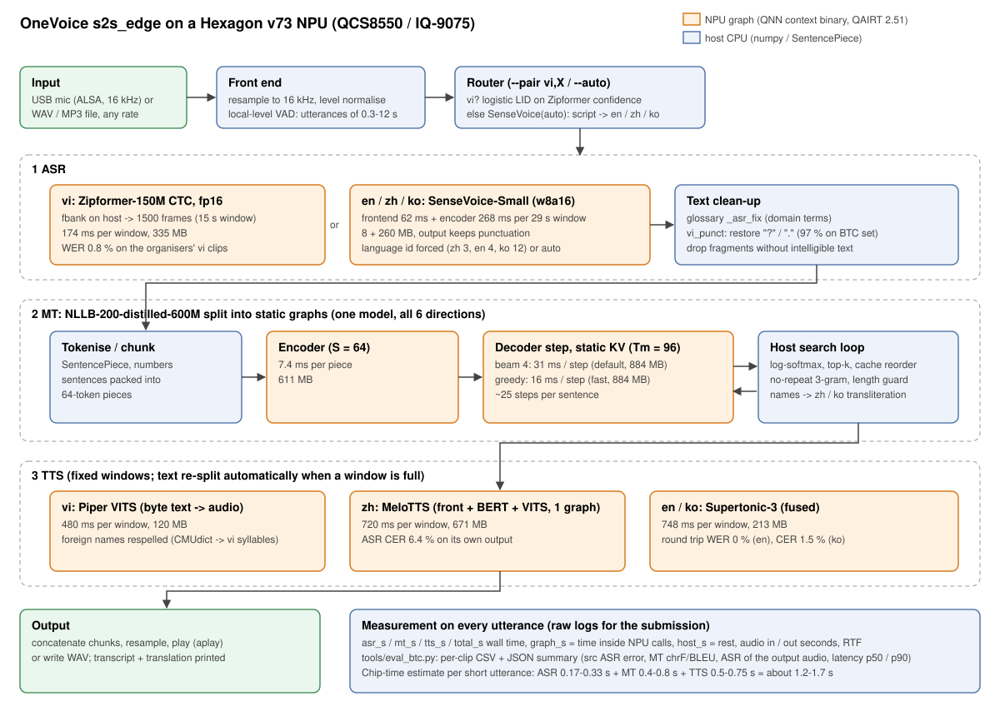

# Báo cáo: Triển khai OneVoice S2S lên HSPTEK AIBOX 8550 (QCS8550) với dữ liệu mẫu của BTC

Phạm vi: dịch giọng nói sang giọng nói 6 chiều (Việt ↔ Anh, Việt ↔ Trung, Việt ↔ Hàn), chạy hoàn toàn trên thiết bị, offline.
Ngày: 09/11/2026. Mã nguồn: nhánh `s2s` của repo OneVoice (thư mục `s2s_edge/`).

Cách đọc: **[đo]** là số đã đo, **[ước tính]** là số tính từ các phép đo khác, **[chưa kiểm chứng]** là thông tin lấy từ tài liệu và chưa chạy thật.

---

## 0. Tóm tắt

| Câu hỏi | Trả lời ngắn |
|---|---|
| Model có hợp chip QCS8550 không? | **Có, đã kiểm chứng trên chip.** 9 graph đã được link lại cho "QCS8550 (Proxy)" với QAIRT 2.51, và cả 9 **nạp và chạy được trên QCS8550 của AI Hub** (profile job), thời gian gần như IQ-9075 (bảng ở mục 1.4). Không phải biên dịch hay sửa graph. Bộ `.bin` mới nằm trong gói ở `models_qcs8550/`. |
| Gói cài có chạy trên hệ điều hành của hộp không? | Phụ thuộc OS. Ubuntu 24.04 (Python 3.12) và Ubuntu 22.04 (Python 3.10, glibc 2.35) đều có wheel `qai_appbuilder 2.51.40` chính thức; cả hai đã nằm trong gói. **Ubuntu 20.04 (Python 3.8, glibc 2.31) thì không**: phải chạy trong container (`tools/docker_run.sh`) hoặc nạp lại Ubuntu 22.04. |
| Chất lượng trên dữ liệu BTC? | 30 câu mỗi chiều, 6 chiều **[đo, CPU, cùng trọng số với bản NPU]**, bảng ở mục 4.2. ASR tốt (lỗi 1–6%, riêng tiếng Anh hội thoại 18%); TTS gần như không làm mất chất lượng; điểm yếu là **MT cho cặp Hàn/Trung**. Bộ khôi phục dấu câu mới tăng vi→en chrF 53,8 → 55,6 và vi→ko BLEU 23,8 → 30,0. |
| Độ trễ? | Thời gian chip trên QCS8550 **[đo từng graph]**, cộng lại **[ước tính]**: khoảng 1,2–1,7 giây cho một câu ngắn. Chưa có số đo đầu-cuối trên thiết bị thật; `tools/run_btc.sh` sẽ đo khi có máy. |
| Dung lượng model? | 9 file, tổng ~4,0 GB. Một chiều dịch nạp ~2,2 GB. Bản greedy bỏ được decoder beam (884 MB). |
| Việc cần làm ngay | (1) mang theo gói (8,2 GB: bộ `.bin` QCS8550 + bộ IQ-9075 dự phòng) + dữ liệu + USB mic/loa; (2) trên máy: `recon.sh` → `install.sh` → `session0.sh` (tự chọn bộ model nạp được) → `run_btc.sh`. |

---

## 1. Thiết bị: đánh giá lại báo cáo HSPTEK AIBOX 8550

### 1.1 Những điểm đúng và quan trọng
- SoC QCS8550, NPU Hexagon **v73** (cùng thế hệ với IQ-9075), RAM 16 GB, 128 GB lưu trữ, 1× RJ45, 4× USB 3.0, cổng DisplayPort.
- **Hộp không có mic hay loa sẵn.** Cần mang **USB mic + USB loa** (hoặc USB speakerphone), dùng qua `snd-usb-audio`.
- Cần FastRPC (`/dev/fastrpc-cdsp`), `libcdsprpc.so` và quyền Unsigned PD để CPU gọi được NPU.
- `ADSP_LIBRARY_PATH` dùng dấu `;`. Wheel `qai_appbuilder` tự đặt biến này trỏ vào thư mục skel đi kèm; tôi đã kiểm tra mã trong wheel (`qnncontext.py`).

### 1.2 Những điểm trong báo cáo HSPTEK cần sửa trước khi dùng
Mục 9 của báo cáo đó **không khớp với hệ thống ta đã xây dựng và đo**:

| Báo cáo HSPTEK ghi | Thực tế của ta |
|---|---|
| MeloTTS cho **tiếng Việt**, Piper cho EN/ZH | Ngược lại: **Piper = tiếng Việt**, MeloTTS = **tiếng Trung**, Supertonic = Anh/Hàn |
| Tổng ~1,48 GB đĩa, ~2,2 GB RAM | 9 graph = **~4,0 GB** (NLLB một mình ~2,4 GB cho encoder + 2 decoder) |
| Đầu-cuối < 500 ms, RTF < 0,25 | Chip ước tính **1,2–1,7 s/câu ngắn**; TTS có cửa sổ cố định ~0,5–0,75 s |
| NLLB "ctranslate2 + QNN", Dec ~120 ms | NLLB chạy hoàn toàn trên NPU dạng graph tĩnh: encoder 7,4 ms + mỗi bước decoder 16 ms (greedy) / 31 ms (beam 4) |
| SenseVoice ~68 ms | frontend 62 ms + encoder 268 ms cho cửa sổ 29 s **[đo]** |
| Zipformer-30M, ~46 ms | Zipformer-**150M** CTC fp16, 174 ms cho cửa sổ 15 s **[đo]** |
| "Tương thích 100%" | Chưa chạy trên QCS8550 lần nào. Tương thích kiến trúc thì có cơ sở, còn hệ điều hành và runtime thì chưa biết |
| Có GTCRN + Silero VAD | GTCRN đã đo và **không giúp** hai ASR này (WER tăng nhẹ) nên tắt mặc định; VAD dùng thuật toán năng lượng theo mức cục bộ, không cần model |

Nên dùng bảng số trong `docs/chip_results.md` và báo cáo này khi viết bản nộp.

### 1.3 Ma trận tương thích hệ điều hành và cách chạy

| OS trên hộp | Python / glibc | Cách chạy NPU | Trạng thái |
|---|---|---|---|
| Ubuntu 24.04 | 3.12 / 2.39 | `bash install.sh` (dùng `wheelhouse/`) | wheel đã có trong gói |
| Ubuntu 22.04 | 3.10 / 2.35 | `bash install.sh` (tự chọn `wheelhouse_cp310/`) | wheel `qai_appbuilder-2.51.40-cp310-manylinux_2_35` đã tải về |
| Ubuntu 20.04 | 3.8 / 2.31 | `bash tools/docker_run.sh bash tools/session0.sh` (container Debian 12, Python 3.10, truyền thiết bị FastRPC vào) | cần Docker trên hộp và image `python:3.10-slim-bookworm` (arm64) mang theo dạng `.tar` |
| Android 13 | — | Không hỗ trợ trong gói này. Phải chuyển sang Ubuntu (QFIL/EDL theo BSP của HSPTEK) | — |
| Yocto / Qualcomm Linux | khác nhau | Thử `install.sh`; nếu Python lệch thì dùng container | — |

Lý do cả ba phiên bản Ubuntu đều dùng **QAIRT 2.51**: các file `.bin` được link với `--qairt_version 2.51`, và runtime bên trong wheel phải cùng phiên bản đó.

### 1.4 Context binary cho QCS8550
- `.bin` của IQ-9075 **có thể** nạp được trên QCS8550 vì cùng v73, nhưng tài liệu QNN liệt kê QCS8550 và SM8550 với *SoC model* khác nhau. Không nên đánh cược vào việc này.
- **Đã làm (09/11):** `python tools/relink_device.py --device "QCS8550 (Proxy)" --qairt 2.51 --out models_qcs8550 --dlc` gửi 9 link job (id trong `models_qcs8550/link_jobs.json`) từ đúng các model đã biên dịch, tải 9 `.bin` (tổng 4,0 GB) và 9 `.dlc` dự phòng (tổng 7,9 GB, **không** nằm trong gói chính vì quá lớn; để riêng trong `s2s_pkg/models_qcs8550/`).
- **Kiểm chứng trên chip** (`tools/profile_links.py`, profile job trên QCS8550 của AI Hub), thời gian mỗi lần gọi graph **[đo]**:

| Graph | QCS8550 | IQ-9075 | Bộ nhớ đỉnh QCS8550 |
|---|---|---|---|
| ASR vi Zipformer (cửa sổ 15 s) | 163,4 ms | 174,3 ms | 95 MB |
| SenseVoice frontend / encoder (cửa sổ 29 s) | 58,3 / 236,5 ms | 62,5 / 268,0 ms | 93 / 95 MB |
| NLLB encoder (64 token) | 7,5 ms | 7,4 ms | 99 MB |
| NLLB decoder bước greedy / beam 4 | 15,2 / 30,8 ms | 16,1 / 31,0 ms | 132 / 216 MB |
| TTS vi Piper | 520,1 ms | 480 ms | 95 MB |
| TTS zh Melo | 740,6 ms | 720,2 ms | 92 MB |
| TTS en/ko Supertonic | 701,2 ms | 748,3 ms | 96 MB |

Profile job id: asr_vi `jgl8z82ep`, frontend `jp37371xg`, encoder `jpvmomr7p`, mt_enc `jgjymy27g`, mt_dec `jpex1xw7g`, mt_decB `jp11l1wkp`, tts_vi `j57nwnlqp`, tts_zh `jp44o4dqp`, tts_enko `jpxrjr6jp`.

- Thứ tự thử trên máy (`session0.sh` làm tự động, ghi bộ chọn được vào `logs/models_ok.txt`): `models_qcs8550/` → `models/` (IQ-9075) → `.dlc` (sửa `"ctx"` trong `models.json` bằng tay; thiết bị tự chuẩn bị graph ở lần nạp đầu, chậm nhưng không phụ thuộc SoC).
- Ghi chú: "QCS8550 (Proxy)" trên AI Hub là máy **Android** có chip QCS8550. Nó chứng minh file nạp được trên chip này; còn hệ điều hành Linux của AIBOX vẫn phải kiểm tra tại chỗ (mục 1.3).

---

## 2. Dữ liệu mẫu của BTC (Google Drive)

Đã tải đủ 1.644 file (143 MB) về `Downloads/onevoice_btc_data/` bằng một script đọc thư mục Drive công khai, vì `gdown` bị kẹt ở giới hạn 50 file.

| Bộ | Số câu | Thời lượng (min / trung vị / max) | Định dạng audio | Văn bản |
|---|---|---|---|---|
| Việt → Anh (`Vie-Eng/wav`) | 100 | 2,1 / 3,3 / 7,3 s | WAV 16 kHz | câu tự nhiên có dấu câu |
| Anh → Việt (`Eng-Vie/wav`) | 100 | 2,4 / 5,5 / 13,4 s | WAV 16 kHz | **đã chuẩn hóa**: chữ thường, không dấu câu, số viết thành chữ (kiểu câu lệnh trợ lý ảo) |
| Việt ↔ Hàn | 180 + 180 | vi 0,6 / 2,2 / 6,8 s; ko 1,7 / 2,6 / 33,9 s | vi: WAV 16–48 kHz lẫn MP3; **ko: MP3 24 kHz nhưng đặt đuôi `.wav`** | câu giao tiếp du lịch, rất ngắn |
| Việt ↔ Trung | 180 + 180 | vi 1,1 / 3,1 / 11,1 s; zh 1,5 / 2,7 / 8,8 s | trộn 16 / 22,05 / 24 / 44,1 / 48 kHz, WAV và MP3 | câu giao tiếp |

Những gì dữ liệu cho thấy về bộ test ẩn:

1. **Câu rất ngắn, mang tính hội thoại** (trung vị 2–3 s). Độ trễ cố định của TTS (cửa sổ tĩnh) chiếm phần lớn thời gian. Câu hỏi rất nhiều (174/431 câu tiếng Việt là câu hỏi).
2. **Định dạng audio không đồng nhất.** Bộ nạp phải tự đọc MP3 và resample. `soundfile` bản aarch64 đọc được MP3; `eval_btc.py` có thêm đường dự phòng qua `ffmpeg`.
3. **Nhãn và audio có lỗi.** Có câu tiếng Việt mang dấu vết ASR ("Mát mê", "Ống hục ở đâu?"), có cặp lệch nghĩa (VK-0242: "Xe buýt có máy lạnh không?" ↔ "베트남어 가이드가 있나요?"), VK-9110 có câu tiếng Hàn lặp vô hạn, một nhãn tiếng Việt bộ Việt-Trung chỉ ghi đoạn cuối của câu nói ("Được điểm tối đa." cho một câu dài 6,9 s), và file EV-2748 gần như câm (76% mẫu bằng 0, đỉnh 0,007). `eval_btc.py` tự đánh dấu các câu bất thường và cho điểm trên cả tập đầy đủ lẫn tập sạch. Điểm tuyệt đối trên bộ này sẽ thấp hơn trên FLORES; nên dùng nó để **so sánh các phiên bản với nhau**.
4. Tham chiếu tiếng Việt của chiều Anh→Việt **viết số bằng chữ**, nên khi chấm phải chuẩn hóa số ở cả hai phía (`textnorm.normalize`).

---

## 3. Cách chạy trên thiết bị thật

### 3.1 Chuẩn bị trên laptop (trước khi đến VNG)
Gói hiện tại `s2s_pkg/dist/s2s_edge_pkg` (8,2 GB) **đã có đủ**: code, `models_qcs8550/` (link 09/11, đã profile trên QCS8550), `models/` (IQ-9075), `wheelhouse/` (py3.12), `wheelhouse_cp310/` (py3.10), tài liệu. Chỉ cần làm lại các lệnh dưới khi đổi model:
```bash
# 1. link lại cho QCS8550 (đã làm 09/11; khoảng 10-30 phút trên AI Hub) và profile trên chip
python tools/relink_device.py --device "QCS8550 (Proxy)" --qairt 2.51 --out models_qcs8550 --dlc
python tools/profile_links.py --links models_qcs8550/link_jobs.json --device "QCS8550 (Proxy)" --out models_qcs8550/profile.json
# 2. dựng gói: code + models + 2 wheelhouse (py3.12 và py3.10)
python tools/build_package.py --models-dir <models> --wheelhouse <wheelhouse_cp312> --wheelhouse310 <wheelhouse_cp310> --out dist/s2s_edge_pkg
# 3. (chỉ khi hộp chạy Ubuntu 20.04) image container dự phòng
docker pull --platform linux/arm64 python:3.10-slim-bookworm && docker save -o py310_arm64.tar python:3.10-slim-bookworm
```
Mang theo: ổ USB ≥ 16 GB (gói 8,2 GB + dữ liệu BTC 143 MB + `py310_arm64.tar`; nếu cần thêm bộ `.dlc` 7,9 GB thì dùng ổ 32 GB), USB mic + USB loa, cáp LAN, cáp USB-C/micro-USB (cho adb/serial), bàn phím.

### 3.2 Trên hộp (theo thứ tự, mỗi bước có log)
```bash
# chép gói: ổ USB, hoặc scp/rsync qua cáp LAN nối thẳng (laptop 192.168.10.1 <-> hộp 192.168.10.2)
rsync -avP s2s_edge_pkg/ <user>@192.168.10.2:~/s2s_edge_pkg/
cd ~/s2s_edge_pkg
bash tools/recon.sh            # 1-2 phút: OS, glibc, Python, FastRPC, thư viện QNN, audio, USB, Docker
bash install.sh                # tự chọn wheelhouse theo Python; báo rõ nếu phải dùng container
bash tools/session0.sh         # golden check từng graph (thử models_qcs8550 rồi models), smoke test, benchmark; đóng gói log .tgz
bash tools/run_btc.sh ~/onevoice_btc_data 30     # 30 câu mỗi chiều (đổi 0 = toàn bộ ~920 câu); dùng bộ model session0 đã chọn
```
Nếu cả hai bộ `.bin` đều bị từ chối: chép bộ `.dlc` vào một thư mục, sửa khóa `"ctx"` trong `models.json` cho trỏ tới `.dlc`, rồi `MODELS=<thư mục>/models.json bash tools/session0.sh`.

### 3.3 Demo và quay video (yêu cầu của BTC: tắt mạng)
```bash
sudo nmcli networking off     # hoặc rút cáp LAN; quay màn hình lệnh `ip -br addr` và `ping 8.8.8.8` thất bại
arecord -l; aplay -l          # kiểm tra USB mic/loa
python -m s2s_edge live --pair vi,ko --models models/models.json --backend npu      # hai người nói luân phiên
python -m s2s_edge live --auto --partner en --models models/models.json --backend npu
```

### 3.4 Thu kết quả để nộp
`logs/session0_*.tgz` và `logs/btc_*.tgz` chứa log thô: thời gian từng chặng của từng câu, thời gian trong NPU, RTF, điểm chất lượng, môi trường máy. Đây là "raw logs" mà mẫu nộp bài yêu cầu.

---

## 4. Pipeline, chất lượng, độ trễ

### 4.1 Hình pipeline


Ghép model: mỗi khối cam là một graph QNN tĩnh trên NPU; phần việc nhỏ (fbank, SentencePiece, vòng lặp beam search, chuẩn hóa số, ghép audio) chạy trên CPU. Graph được nạp một lần khi khởi động và giữ trong RAM, nên không có cold start giữa các câu. Đề bài **không bắt buộc 100% NPU**; host CPU làm vòng lặp và tokenizer là hợp lệ.

### 4.2 Kết quả trên dữ liệu BTC (30 câu mỗi chiều, CPU, cùng trọng số với bản NPU)
`tools/eval_btc.py`, log: `logs/btc_cpu30*.json` và `.csv` (từng câu).

Lỗi ASR tính trên toàn tập (tổng lỗi / tổng độ dài nhãn). Điểm tính trên tập sạch (bỏ câu có nhãn hỏng; số câu trong ngoặc). Tóm tắt lại bất cứ lúc nào bằng: `python tools/eval_btc.py --summarize logs/btc_cpu30*.json`.

| Chiều | n (sạch) | Lỗi ASR nguồn | MT từ văn bản chuẩn chrF / BLEU | MT từ ASR chrF / BLEU | Đầu-cuối (ASR của audio ra) chrF / BLEU |
|---|---|---|---|---|---|
| vi→en | 30 (30) | WER 0,8% | 56,4 / 38,9 | 53,8 / 33,9 → **55,6 / 37,8** với `vi_punct` | 53,9 / 34,0 (chưa có `vi_punct`) |
| en→vi | 30 (30) | WER 17,8% | 58,3 / 36,6 | 53,0 / 34,1 | 50,3 / 32,3 |
| vi→ko | 30 (30) | WER 5,8% | 33,0 / 34,6 | 24,1 / 23,8 → **25,7 / 30,0** với `vi_punct` | 21,6 / 21,8 (chưa có `vi_punct`) |
| ko→vi | 30 (30) | CER 1,0% | 39,8 / 19,0 | 35,1 / 14,9 | 34,4 / 14,4 |
| vi→zh | 30 (29) | WER 4,9% | 37,7 / 44,7 | 32,4 / 39,2 (có `vi_punct`) | 31,5 / 38,1 |
| zh→vi | 30 (30) | CER 2,5% | 50,6 / 29,3 | 50,3 / 29,7 | 50,3 / 29,7 |

Nhận xét:

- **Bản dịch đọc ra nghe lại gần như khớp văn bản dịch** (cột cuối thấp hơn cột "MT từ ASR" chỉ 0–3 điểm), nên TTS không phải là chỗ mất chất lượng. Phần mất nằm ở **MT** (vi→ko, ko→vi, vi→zh thấp ngay cả khi dịch từ văn bản chuẩn) và ở **ASR tiếng Anh hội thoại** (en→vi: từ đệm "um/uh", nói nhanh; có 1 file hỏng là EV-2748, 76% mẫu bằng 0).
- chrF của tiếng Hàn/Trung thấp một phần do cách tính trên ký tự; BLEU tiếng Trung tính theo ký tự nên cao hơn. So sánh theo **chênh lệch giữa các phiên bản**, không theo giá trị tuyệt đối.
- Thời gian đo trên laptop (CPU fp32, 30–60 s/câu) **không phải** độ trễ thiết bị. Thời gian chip trên QCS8550 ở mục 1.4; số đầu-cuối thật sẽ do `run_btc.sh` đo trên NPU.

### 4.3 Các bước đã làm để tăng chất lượng (đều đã đo)
| Bước | Tác dụng đo được |
|---|---|
| NLLB chia encoder + decoder-step, nguồn 64 token (thay cho 32) | vi→en chrF 51,0 → 54,7 (FLORES) |
| Beam 4 trên NPU (decoder theo lô 4) | +2,3 chrF, khớp HF fp32 (57,0 so với 57,2) |
| Chặn lặp 3-gram + giới hạn độ dài | bỏ được lỗi lặp vô hạn |
| VAD theo mức cục bộ | en→vi chrF 19 → 47 trên mic nhỏ tiếng |
| TTS tự chia lại văn bản khi đầy cửa sổ tĩnh | hết hiện tượng mất đuôi câu (Melo, Supertonic) |
| **Mới:** khôi phục dấu câu tiếng Việt (`textnorm.vi_punct`) trước MT | đúng 97,0% dấu cuối câu trên 431 câu BTC (nhận ra 169/174 câu hỏi); trên FLORES (không dùng để chỉnh luật) nhầm 6/126 câu kể; vi→en chrF 53,8 → 55,6, BLEU 33,9 → 37,8; vi→ko chrF 24,1 → 25,7, BLEU 23,8 → 30,0. *Luật được chỉnh trên chính bộ BTC, nên mức tăng trên bộ test ẩn có thể nhỏ hơn.* |
| Thử và **bỏ**: sửa dấu cách trong ASR tiếng Hàn (SenseVoice tách "있 어요", "시 간") | ko→vi chrF: giữ nguyên 35,1; bỏ hết dấu cách 34,9; luật nối đuôi/trợ từ 33,6. Không cách nào tốt hơn, nên không đưa vào |
| **Mới:** ASR không còn crash với đoạn audio < 100 ms | lỗi tìm ra khi chạy bộ BTC (cũng sẽ xảy ra khi nói rất ngắn trên máy thật) |
| Tên riêng: Piper đọc tên nước ngoài bằng âm tiết Việt; zh/ko phiên âm qua NLLB | không còn mất từ khi đọc |

### 4.4 Đề xuất tiếp theo (theo thứ tự lợi ích / rủi ro)
1. **Đo trên thiết bị thật** (`run_btc.sh`). Mọi đề xuất khác cần số này.
2. **Độ trễ TTS cho câu ngắn:** TTS luôn tính hết cửa sổ cố định (Piper 480 ms cho 40 cửa sổ, Supertonic 748 ms cho 150 khung), trong khi câu BTC chỉ 2–3 s. Biên dịch thêm một **bản cửa sổ nhỏ** cho mỗi TTS (ví dụ 1/3 độ dài) và chọn theo độ dài văn bản. Ước tính giảm 0,3–0,5 s/câu; tốn thêm ~0,5 GB.
3. **Greedy cho câu ngắn, beam cho câu dài:** câu < 8 token dùng `mt_dec` (16 ms/bước), còn lại dùng beam. Cần đo xem chất lượng trên câu ngắn có giảm không.
4. **Chạy song song (pipelining):** TTS câu *i* trong khi ASR/MT câu *i+1* (ASR ở mic thật chồng lên lúc người nói). Không giảm thời gian một câu, nhưng giảm thời gian chờ trong hội thoại dài.
5. **vi→ko / vi→zh** là điểm yếu (chrF trên FLORES 17–22). Muốn tăng thật thì phải dùng model dịch khác (NLLB-1.3B: nặng gấp đôi; đã đánh giá là không đáng với độ trễ hiện tại) hoặc tinh chỉnh trên câu giao tiếp. Chưa nên làm trước hạn 13/11.
6. **Câu hỏi tiếng Việt kết thúc bằng "à/ư/nhỉ"** và câu có dấu phẩy ("Đúng, tôi …"): ASR CTC không có dấu phẩy. Có thể thêm luật tách từ đệm đầu câu ("vâng", "đúng", "được") thành cụm có dấu phẩy. Mức tăng nhỏ, rủi ro thấp.

### 4.5 Dung lượng
| Khối | File | MB |
|---|---|---|
| ASR | Zipformer vi 335, SenseVoice 8 + 260 | 603 |
| MT | encoder 611, decoder greedy 884, decoder beam 884 | 2.379 |
| TTS | Piper vi 120, Melo zh 671, Supertonic en/ko 213 | 1.004 |
| **Tổng** | 9 graph | **~3.990** |
Chỉ cần một chế độ thì giữ một decoder (bỏ 884 MB): `models_fast.json` = greedy, `models.json` = beam.

---

## 5. Tình huống thường gặp và cách xử lý

| Tình huống | Dấu hiệu | Xử lý |
|---|---|---|
| Python/glibc không hợp wheel | `install.sh` báo "No wheelhouse for Python 38" hoặc pip từ chối wheel | Ubuntu 22.04/24.04: cài `python3.10`/`python3.12` từ gói OS. Ubuntu 20.04: `tools/docker_run.sh`. Nếu không có Docker: nạp lại Ubuntu 22.04 theo BSP HSPTEK |
| Không thấy NPU | `ls /dev | grep rpc` rỗng, QNN báo lỗi tạo device | image thiếu FastRPC hoặc firmware CDSP. Hỏi HSPTEK/VNG bản image có NPU; tạm chạy `--backend cpu` (rất chậm) chỉ để chứng minh chức năng |
| `.bin` bị từ chối | lỗi "incompatible" / "soc" / "version" khi nạp context | thử `.bin` QCS8550 → `.bin` IQ-9075 → `.dlc`; chạy `golden.py check` sau mỗi lần đổi |
| Lỗi Unsigned PD | "unsigned PD not supported" trong log | image phải bật Unsigned PD, hoặc dùng skel đã ký của BSP: đặt `ADSP_LIBRARY_PATH` trỏ vào `/usr/lib/rfsa/adsp` (thư viện cùng phiên bản 2.51) |
| Thiếu RAM | bị kill khi nạp, `free -h` thấp | dùng `models_fast.json` (bỏ decoder beam), hoặc chế độ `--pair` thay vì `--auto` (không nạp cả hai ASR) |
| Không thu được tiếng | `arecord -l` không thấy USB mic | thử cổng USB khác; `arecord -D plughw:1,0`; đặt mic làm mặc định trong PipeWire/PulseAudio |
| Tiếng quá nhỏ / ồn | ASR rỗng hoặc sai | đã có chuẩn hóa mức âm và VAD cục bộ; đặt mic gần; `--denoise` chỉ dùng khi ồn nặng (đo cho thấy không giúp ở 5 dB) |
| Câu dài > 12 s | bị cắt | VAD tự tách ở chỗ ngắt; MT chia mảnh 64 token; TTS tự chia lại. Không cần làm gì |
| Câu quá ngắn ("Vâng.") | trước đây có thể crash | đã sửa: đoạn < 100 ms bỏ qua, đoạn không có chữ thì không dịch |
| Nhận nhầm ngôn ngữ (chế độ `--auto`) | tiếng Việt rất ngắn hoặc ồn bị coi là tiếng nước ngoài | dùng `--pair vi,X` khi biết cặp; nếu sai đều một phía thì chỉnh `LanguageID(bias=...)` |
| File audio lạ | MP3 đặt đuôi `.wav`, nhiều tần số mẫu | `soundfile` đọc MP3; có dự phòng `ffmpeg`; mọi file được resample về 16 kHz |
| Thuật ngữ chuyên ngành | ASR viết sai ("ếch xen") | thêm vào `glossary.json` phần `_asr_fix`; tên riêng thêm bản đọc vi/zh/ko |
| Quay video phải tắt mạng | — | `nmcli networking off`; mọi thứ (model, wheel, font giao diện) đã nằm trong gói |

---

## 6. Code đã chuẩn bị cho lần nạp lên máy

| File | Việc |
|---|---|
| `tools/eval_btc.py` | chạy bộ BTC: đọc Excel, MP3, chấm ASR (toàn tập) / MT / đầu-cuối / độ trễ, đánh dấu nhãn hỏng, xuất CSV + JSON; `--summarize` in bảng từ log đã lưu |
| `tools/run_btc.sh` | chạy 6 chiều trên NPU, đóng gói log |
| `tools/relink_device.py` | link lại 9 graph cho thiết bị v73 khác (QCS8550), tải `.bin` + `.dlc` |
| `tools/profile_links.py` | profile các `.bin` mới trên chip của AI Hub (chứng minh nạp được + thời gian chip) |
| `tools/session0.sh` | thử lần lượt các bộ model đến khi mọi graph qua golden check, ghi bộ chọn được vào `logs/models_ok.txt` |
| `tools/golden.py` | graph lỗi không làm dừng các graph khác; trả mã lỗi khác 0 khi có graph hỏng |
| `tools/docker_run.sh` | chạy gói trong container khi OS quá cũ, có truyền FastRPC + USB audio |
| `tools/recon.sh` | thêm kiểm tra glibc, venv, Docker, thiết bị USB |
| `tools/build_package.py` | `install.sh` mới: tự chọn wheel theo Python, báo lỗi rõ ràng; thêm `--wheelhouse310` |
| `tools/eval_vi_punct.py` | đo bộ khôi phục dấu câu |
| `s2s_edge/textnorm.py` | `vi_punct()` |
| `s2s_edge/conversation.py` | gọi `vi_punct` trước MT khi nguồn là tiếng Việt |
| `s2s_edge/asr.py` | chặn crash với audio < 100 ms |
| `docs/pipeline.svg` | hình pipeline |

## Nguồn
- Báo cáo HSPTEK AIBOX 8550 (tài liệu nội bộ của nhóm), trang sản phẩm https://hsptek.com/san-pham/aibox-8550/
- qai_appbuilder 2.51.40 releases (wheel cp310 manylinux_2_35 và cp312 manylinux_2_39): https://github.com/quic/ai-engine-direct-helper/releases/tag/v2.51.40
- QNN: context binary gắn với kiến trúc HTP và SoC, SM8550 và QCS8550 là hai SoC model khác nhau: https://qairt-2-44-docs.pages.dev/QNN/general/overview
- Radxa: cài QAI AppBuilder trên Linux, `ADSP_LIBRARY_PATH`: https://docs.radxa.com/dragon/q6a/app-dev/npu-dev/qai-appbuilder
- Danh sách thiết bị AI Hub (truy vấn ngày 09/11/2026): "QCS8550 (Proxy)", hexagon v73, fp16
